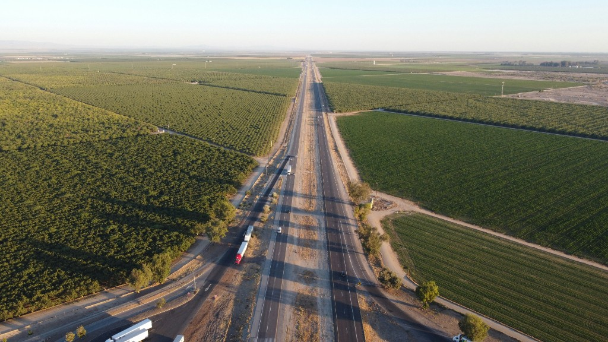

::: {.hub-essay}

I enjoy understanding how things work, solving problems, and developing learning experiences that help other people do the same.

My background is in mathematics, and my work spans statistics, computing, and education. I've worked on statistical methods and applications in medical research, developed software to support statistical reasoning, and designed courses and projects that help students learn by working on real problems. I'm particularly interested in how we use data and evidence to make decisions, and in making technical ideas interesting and accessible.

I currently teach mathematics, statistics, and data science at [Cal Poly Humboldt](https://www.humboldt.edu). Previously, I taught at Oregon Institute of Technology and the University of Toronto Mississauga, and worked as a statistician at UC San Diego, Ghent University in Belgium, and Umeå University in Sweden. I earned my Ph.D. in mathematics at UC San Diego.

This site brings together my research, projects, teaching materials, and things I'm learning.

:::

::: {.hub-figure}

Photo by [Jabez Impano](https://unsplash.com/@jabezimpano) on [Unsplash](https://unsplash.com/photos/4QxG4S3IM3E).
:::

## Pathways

::: {.hub-pathways}
1. [**Projects**](projects/index.qmd) — Research, software, and other projects, both completed and in progress.
2. [**Teaching**](teaching/index.qmd) — Course materials for students and open resources for instructors.
3. [**Learning**](self-study/index.qmd) — Self-paced paths for independent study.
4. [**Misc**](misc/index.qmd) — Other interests and experiments.
:::

## Selected work

| Work | Explore |
|------|---------|
| Unsupervised learning project | [Simple major recommender](https://github.com/roverhol/simple_major_recommender)  |
| Statsbert | [Project overview](projects/index.qmd#statsbert) |

## Contact

- **Email:** rho3 at humboldt.edu (current) or rosanna.haut at gmail.com (personal)
- **Office:** BSS 334
- **Department:** [Mathematics, Cal Poly Humboldt](https://www.humboldt.edu/mathematics)

[About →](about.qmd)
